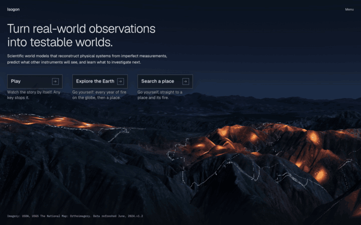
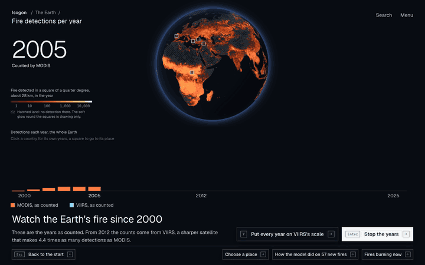
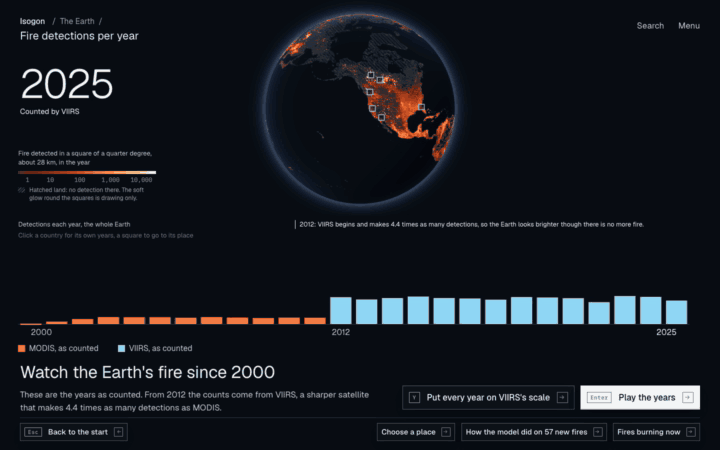
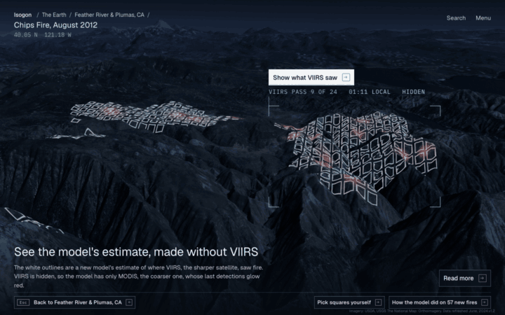
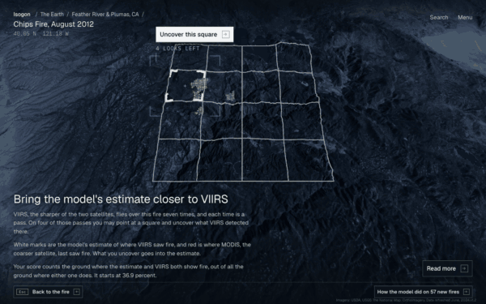
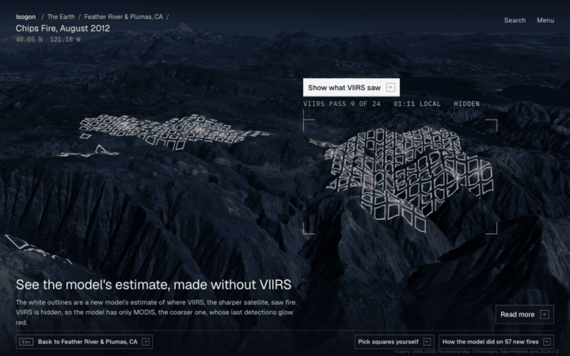
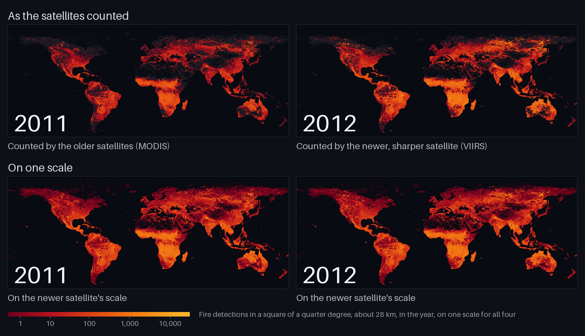
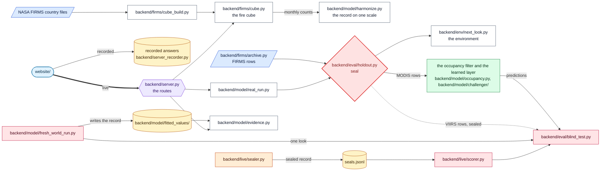

# Isogon

<table>
<tr>
<td width="50%" valign="top"><a href="docs/clips/01-landing.mp4"></a><br>The first screen. Satellite detections of the Chips Fire, Feather River &amp; Plumas, CA, in August 2012, on its terrain, then the model's estimate of where fire is detected. <a href="docs/clips/01-landing.mp4">MP4</a></td>
<td width="50%" valign="top"><a href="docs/clips/02-earth-years.mp4"></a><br>The Earth's fire detections each year since 2000. From 2012 VIIRS, a sharper satellite, makes 4.4 times as many detections as MODIS. On one scale the MODIS years are raised to what VIIRS would count, and 2012 shows no jump. <a href="docs/clips/02-earth-years.mp4">MP4</a></td>
</tr>
<tr>
<td width="50%" valign="top"><a href="docs/clips/03-descent.mp4"></a><br>From the Earth into a place. Pointing at a pin names the place, and a click flies down into Feather River &amp; Plumas, CA. <a href="docs/clips/03-descent.mp4">MP4</a></td>
<td width="50%" valign="top"><a href="docs/clips/04-fire-reveal.mp4"></a><br>The Chips Fire with VIIRS hidden: the white outlines are the model's estimate, made without VIIRS. Then what VIIRS detected is shown in blue. On this fire the estimate matched VIIRS on 77 percent within one pixel, against 58 for MODIS alone. <a href="docs/clips/04-fire-reveal.mp4">MP4</a></td>
</tr>
<tr>
<td width="50%" valign="top"><a href="docs/clips/05-your-turn.mp4"></a><br>Pick squares yourself. Each look uncovers what VIIRS detected in one square, and it goes into the estimate. Here the score rose with each look. <a href="docs/clips/05-your-turn.mp4">MP4</a></td>
<td width="50%" valign="top"><a href="docs/clips/06-tested-fires.mp4"></a><br>How the model did on 57 new fires, picked by a fixed rule before any result was seen. Within one pixel the new model matched VIIRS 40 percent better than MODIS alone, 36.9 against 26.4 percent. <a href="docs/clips/06-tested-fires.mp4">MP4</a></td>
</tr>
</table>

**Turn real-world observations into testable worlds.**

Isogon rebuilds a wildfire from the detections of one NASA satellite, MODIS, and is graded against those of another,
VIIRS, which it never saw for that fire. On 57 fires picked by a rule before any result was read, its estimate matched
VIIRS 40 percent better than MODIS alone: 36.9 against 26.4 percent within one square. The estimate is made by a simple
filter and a learned layer that reads it.

For fires burning now it writes a prediction down with a fingerprint and a time, before the satellite flies over, so it
cannot be changed afterwards without showing. The prediction it seals is the filter's alone.

It has three parts: a world model, an environment that you or an agent can play by choosing where to look, and a
learning agent as the research direction.

The world model's first result is a record of the Earth's fire on one scale. VIIRS has flown since 2012, sees squares
375 m across against MODIS's 1 km, and makes about 4.4 times as many detections, so a raw record jumps in 2012 though
the burning did not. With each overlap year held out, over 5,227 places, the gap between the two satellites' monthly
counts is cut from 78 percent to 14.

Open the page: https://glendonc.github.io/isogon/. It runs in your browser from recorded answers and the project's
own model.

## Features

1. **A scientific world model.** It rebuilds what was observed from imperfect measurements and predicts what another
   instrument will detect. Here the observations are fire detections. The model has two layers. The first is an
   occupancy filter: three numbers per 375 m cell, corrected at each satellite pass and run forward and backward in
   time. The second is a learned layer, a small neural network and boosted decision trees written in numpy only, that
   reads the filter's fields and the detections near each cell. Putting the MODIS years on the VIIRS scale is the
   first result, and the record of any place on Earth is built on it.
2. **An experimental environment.** A real fire with VIIRS hidden becomes a decision problem. At each real VIIRS pass a
   player may spend one of a few looks on one square of the fire. The hidden detections of that look are revealed, the
   model takes them in, and the look is scored by how much it improves the overlap with VIIRS's detections.
3. **A learning agent, the research direction.** Players choose where to look: some read nothing, some read what the
   model is unsure of, and two are learned, one by regression and one with boosted trees. Neither beats the simple
   rule that looks where the model is least sure. The second learner was measured once on 199 untouched fires of 2023
   to 2025 and was level with the rule: +0.0007, with a 90 percent interval of -0.0001 to +0.0015.

## Results

**The record.** With each overlap year held out in turn, over 5,227 places of two degrees in all 238 countries, the
disagreement between the two satellites' monthly detection counts is cut from 78 percent to 14. One ratio per place,
the method used before, leaves 18 percent.

**The model.** Rebuilding single fires from MODIS alone, with VIIRS hidden, the estimate overlaps VIIRS's detections
about 40 percent better than MODIS alone: 36.9 against 26.4 percent within one square, on 57 fires it had never seen,
chosen by a rule before any was read and looked at once (test B). The result is the blend's, the learned layer reading
the filter; the page calls the blend the new model and the filter the first model. The filter alone did worse than MODIS alone on exact overlap, 13.1 against 15.8 percent, and was level
within one square, 26.6 against 26.4.

Overlap is the squares both mark as detections, out of the squares either marks. The truth these results are scored
against is VIIRS, another instrument, not the fire, and what the model gives is an estimate, not ground truth. The
model is experimental: it is shown and tested, and nothing switches it on as a product.

| Question | Figure | Source |
| --- | --- | --- |
| How many more detections does VIIRS make than MODIS? | About 4.4 times over the whole Earth, summed over 2012 to 2025 (261,995,596 against 59,386,593). | [`docs/harmonization.md`](docs/harmonization.md), `backend/model/harmonize_years.py` |
| How far do the monthly counts differ from VIIRS's own, each overlap year held out? | 77.7 percent with no correction, 18.3 with one ratio per place, 14.1 with the record in use. | [`docs/harmonization.md`](docs/harmonization.md), `backend/model/harmonize_eval.py` |
| Did the stated range hold? | The 80 percent range held on 79 percent of the years that did not set it. | [`docs/harmonization.md`](docs/harmonization.md) |
| Overlap on the 57 fires of test B: the blend, the filter alone, MODIS alone | Exact: 20.4, 13.1, 15.8 percent. Within one square: 36.9, 26.6, 26.4. | `backend/model/fitted_values/fresh_world_test_b.json`, `backend.model.evidence` |
| The stated 90 percent range for a pass's total heat | Held on 88.9 percent of 932 passes for the blend and 87.2 for the filter alone. | `backend/model/fitted_values/fresh_world_test_b.json` |
| Overlap on the 73 fires of test A, chosen by the same rule, the filter alone against MODIS alone | Exact: 16.8 against 19.7 percent, worse. Within one square: 35.6 against 32.6. | `backend/model/fitted_values/fresh_world_test_a.json` |
| Overlap on the three first test fires, 2021, the filter alone against MODIS alone | Exact at Dixie 31.9 against 25.9, at Lytton Creek 19.2 against 12.8, at northern Evia 27.7 against 28.7, worse. Those fires are closed and are not scored again. | `backend/model/fitted_values/test_fire_looks.json` |
| Where should the next look go? 13 rounds of fires of 2024 and 2025 | Looking where the model is least sure raises overlap by 4.8 points from four looks, against 0.6 for random looks and 1.7 for the best fixed square in hindsight, and beats random looks in 13 of 13. The learned player adds 0.25 points to it, most likely between -0.72 and +1.25, so no difference beyond the noise. | `backend/env/fitted/next_look.json`, [`docs/method.md`](docs/method.md) |
| The second learner, measured once on 199 untouched fires of 2023 to 2025, against the same rule | A gain of +0.0007 (0.07 points) over the rule, with a 90 percent interval of -0.0001 to +0.0015: level. The rule gains 0.0411 on these fires and the second learner 0.0418. | `backend/env/fitted/tree_player_test_c.json`, [`docs/method.md`](docs/method.md) |

The figures of the tests are served by the backend at `GET /api/evidence`, which reads the tracked files named above.
The figures of the record come from the fire cube, measured by `python3 -m backend.model.harmonize_eval`. Both are
explained in [`docs/method.md`](docs/method.md) and [`docs/harmonization.md`](docs/harmonization.md).


*Fire detections each year over the whole Earth. Bars: as the satellites counted, MODIS on Terra and Aqua to 2011,
VIIRS on Suomi NPP from 2012. Line: on one scale, the harmonized record. Figures: every country's NASA FIRMS yearly
files, summed by `backend/model/harmonize_years.py` and drawn by `backend/model/harmonize_figure.py`.*



*Fire detections across the Earth in 2011 and 2012. Top, as the satellites counted: MODIS in 2011, and in 2012 VIIRS,
which sees smaller fires and so makes about 4.4 times as many detections over the same Earth. The Earth brightens with
the instrument, not with more burning. Bottom, on one scale: MODIS's detections put on VIIRS's scale, and 2012 shows no
jump. Source: NASA FIRMS country yearly files (MODIS Collection 6.1, VIIRS 375 m Suomi NPP), summed per square of a
quarter degree in the fire cube; drawn by `backend/firms/cube_figure.py`.*

## Predictions sealed before the pass

For fires burning now, the sealer predicts what VIIRS on NOAA-20 and NOAA-21 will detect on each coming pass, from MODIS
detections alone. It writes the prediction down before the pass, with a SHA-256 fingerprint and the time. What it seals
is the occupancy filter's prediction beside the two baselines; the learned layer is not sealed.
`data/live_seals.csv` is the seal log: the time sealed, the fingerprint, the fire, the satellite and the predicted time
of the pass. A line is added as soon as a seal is made and a line already written is never changed. Only a seal that was
pushed to the public repository before its pass has a public timestamp; the time in the log is the sealer's own clock.
When NASA publishes the pass's detections, the sealed prediction is scored, against near real time detections that are
not the checked archive. The scores are served at `GET /api/live`, and [`docs/live.md`](docs/live.md) says how they are
judged.

## Sources

- **NASA FIRMS** active fire detections (MODIS Collection 6.1; VIIRS 375 m for Suomi NPP, NOAA-20 and NOAA-21): the
  country yearly files of all 238 countries (10,095 files, 43.5 GB, no key), read into a monthly cube on a
  quarter-degree grid of 548,501,203 rows; the FIRMS area API, with a free key, for NOAA-21 and the days after the
  last yearly file; near real time rows for the sealed predictions.
- **NASA CMR**, for the times and footprints of every satellite pass.
- **NASA GIBS**, for the day's photograph of a fire's ground, the share of a box under cloud beside each pass, and the
  Earth's picture.
- **Elevation and imagery**: Terrain Tiles on AWS Open Data; USGS The National Map, EOxCloudless and Esri World
  Imagery, each with its credit and terms in [`docs/sources.md`](docs/sources.md).

The public page has no server. It replays answers recorded from the backend, and computes a held-out run and a round of
the game in the visitor's own browser, by the backend's Python compiled to WebAssembly (`backend/browser.py`).

The backend is a Python standard library server with two packages beside it, `numpy` and `Pillow`, and no database;
[`docs/architecture.md`](docs/architecture.md) gives every module and route, with a key to the shapes and colours, and this is its data flow in short:



## Quick start

You need `uv` (it supplies Python 3.12 with `numpy` and `Pillow`) and Node.js 20 or later with `npm`.

```sh
# 1. The backend, on http://127.0.0.1:8788
uv run --no-project --python 3.12 --with numpy --with pillow python3 -m backend.server

# 2. The site, on http://127.0.0.1:5188
cd website && npm ci && npm run dev
```

A fresh clone has no data cache. It runs and draws the tracked Feather River terrain; the records, the real runs,
the tests and the rounds need the data below.

```sh
# Tests and the production build
uv run --no-project --python 3.12 --with numpy --with pillow python3 -m unittest discover -s backend/tests
cd website && npm run build
```

Some backend tests need the data and skip themselves without it.

## Data

Everything downloaded goes under `data/cache/`, which git ignores; the fire cube and its country files go under
`data/cache/world/`, or under the folder `ISOGON_WORLD_DIR` names. The cube, the detections and the passes need no key.

```sh
# The fire cube: every country's yearly files (43.5 GB), then the cube built from them and checked
uv run --no-project --python 3.12 --with numpy --with pillow python3 backend/firms/world_fetch.py fetch
uv run --no-project --python 3.12 --with numpy --with pillow python3 backend/firms/cube_build.py build
uv run --no-project --python 3.12 --with numpy --with pillow python3 backend/firms/cube_build.py check

# FIRMS detections, 2000 to 2025, for the places the page follows pass by pass
uv run --no-project --python 3.12 --with numpy --with pillow python3 -m backend.firms.archive fetch --years 2000-2025

# NASA's list of satellite passes, 2012 to 2025
uv run --no-project --python 3.12 --with numpy --with pillow python3 -m backend.firms.cmr_passes fetch --first 2012-01 --last 2025-12

# Terrain packs and the context terrain around them
uv run --no-project --python 3.12 --with numpy --with pillow python3 -m backend.terrain.terrain_pack build plumas_ca lytton_bc evia_greece
uv run --no-project --python 3.12 --with numpy --with pillow python3 -m backend.terrain.terrain_pack context
```

NOAA-21 rows and recent days come from the FIRMS area API, which needs a free key: copy `.env.example` to `.env`
and set `FIRMS_MAP_KEY` ([`docs/data.md`](docs/data.md)). The site reads the backend's address from
`VITE_API_BASE`. [`docs/cube.md`](docs/cube.md) says how the cube is laid out and checked.

## Limits

- **Truth is another instrument.** The estimate is scored against what VIIRS detected, not against the fire.
- **Cloud is not known.** FIRMS lists detections and no cloud mask, so a pass that detected nothing may have looked
  at cloud.
- **The tests across the world cover 2018 to 2022**, because the country files hold no NOAA-21 rows.
- **The model is small and experimental.** The learned layer was fitted on VIIRS detections of 300 other fires, none of
  them among the 57. The blend was chosen on validation fires before the look at the 57 fires and scored beside the
  filter in the same look. The filter alone is behind MODIS alone on exact overlap on both test A and
  test B. Neither learned player of the agent beats a simple rule.
- **Lava is listed as fire.** Where lava flows every ratio fails, and the record says so.
- **The sealed predictions are scored on near real time detections**, NASA's first detections, not the checked archive.
- **Imagery terms.** Esri World Imagery is published for viewing and not for export; `usgs_naip` is free to share;
  the 2016 EOxCloudless layer may be passed on for non-commercial use with its credit (CC BY-NC-SA 4.0)
  ([`docs/sources.md`](docs/sources.md)).

## Documentation

| Document | Contents |
| --- | --- |
| [`docs/method.md`](docs/method.md) | The model, the protocol of each test, the results and the limits |
| [`docs/harmonization.md`](docs/harmonization.md) | How the record puts MODIS on the VIIRS scale, the methods measured and the rule that chose one |
| [`docs/cube.md`](docs/cube.md) | The fire cube: its files, its build and its checks |
| [`docs/live.md`](docs/live.md) | Predictions sealed before the pass, the seal log and how they are scored |
| [`docs/data.md`](docs/data.md) | Where the data comes from and what the rows can and cannot say |
| [`docs/architecture.md`](docs/architecture.md) | The backend's packages, the file formats and the site |
| [`docs/api.md`](docs/api.md) | Every route of the backend |
| [`docs/sources.md`](docs/sources.md) | Papers, data, imagery, models, fonts and libraries, with their terms |
| [`website/README.md`](website/README.md) | The site's commands and source layout |
| [`openspace/README.md`](openspace/README.md) | An export of one run as a scene for OpenSpace, not yet loaded there by the project |

## Origin and licence

Isogon began at the NASA Space Apps Challenge, as an answer to its challenge "Harmonization of MODIS and VIIRS Hot
Spots".

The code is under the MIT License ([`LICENSE`](LICENSE)). The data, imagery, elevation, spacecraft models, fonts and
libraries it uses stay under their own terms, listed in [`docs/sources.md`](docs/sources.md).
