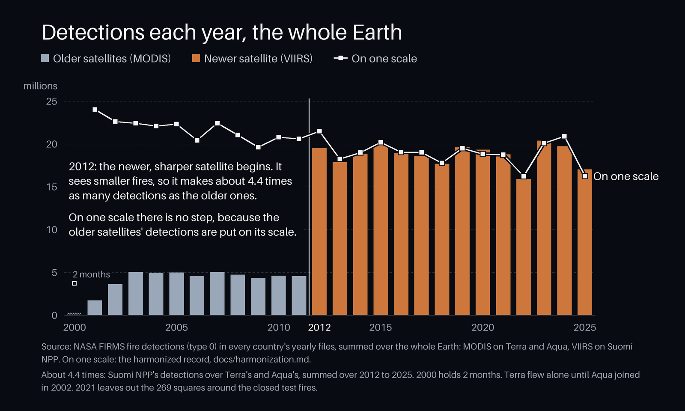

# Isogon

Isogon answers the NASA Space Apps challenge "Harmonization of MODIS and VIIRS Hot Spots". Two kinds of NASA
satellite watch the Earth's fires: MODIS since 2000, which sees squares about 1 km across, and VIIRS since 2012,
which sees squares 375 m across and makes about 4.4 times as many detections of the same fires. Isogon does three
things with them, and the site walks through them as four steps, Record, Estimate, Test and Play:

1. **A fire record for any area on Earth.** Every NASA FIRMS detection from November 2000 to December 2025, in all
   238 countries, with the MODIS years put on the VIIRS scale so the jump of 2012 is gone, and a range for each
   month and year that says how far it may be off.
2. **An estimate, tested.** With VIIRS hidden, an experimental model rebuilds a real fire from MODIS alone on
   VIIRS's 375 m grid. Then the hidden detections are revealed and the estimate is scored beside two simple
   methods, on fires it was never fitted on.
3. **A game of where to look.** The hidden satellite is the answer key: a person, simple rules and a learned player
   choose where a sharp look should go, and each look is scored by how much it improves the estimate.



*Fire detections each year over the whole Earth. Bars: as the satellites counted, MODIS on Terra and Aqua to 2011,
VIIRS on Suomi NPP from 2012. Line: on one scale, the harmonized record. Figures: every country's NASA FIRMS yearly
files, summed by `backend/model/harmonize_years.py` (its yearly totals) and drawn by
`backend/model/harmonize_figure.py`.*


*Fire across the Earth in 2011 and 2012. Top, as the satellites counted: the older satellites (MODIS) in 2011, and in
2012 the newer, sharper one (VIIRS), which makes about 4.4 times as many detections of the same fires, so the Earth
brightens with no more fire. Bottom, on one scale: the older satellites' detections put on the newer one's scale, and
2012 shows no jump. Source: NASA FIRMS country yearly files (MODIS Collection 6.1, VIIRS 375 m Suomi NPP), summed per
square of a quarter degree in the fire cube; drawn by `backend/firms/cube_figure.py`.*

## What is measured

Every figure is served by the backend (`GET /api/evidence`, `GET /api/calendar`, `GET /api/cube/years`) from tracked
files and the fire cube, and explained in [`docs/method.md`](docs/method.md) and
[`docs/harmonization.md`](docs/harmonization.md).

| Question | Result |
| --- | --- |
| How many more detections does VIIRS make? | About 4.4 times over the whole Earth: Suomi NPP against Terra and Aqua together, summed over 2012 to 2025. Year by year, counting 2012 from February (Suomi NPP's rows begin on 20 January), it runs from 4.2 to 4.9, and each place has its own (4.1 around the Feather River). |
| How well does the record put MODIS on the VIIRS scale? | Over 5,227 places of two degrees in all 238 countries, month by month, the method in use misses VIIRS's own count by 14.1 percent, against 18.3 percent for one ratio per place and 77.7 percent with no correction. Its 80 percent range held on 79 percent of the years that did not set it. |
| And on the three places of the first test? | A year hidden and predicted from the others is off by 8 to 12 percent, against 72 to 73 percent with no correction; the range held in 12, 13 and 12 of 13 years. |
| The estimate on the three fires kept as its first test (Dixie, Lytton Creek, northern Evia, 2021) | Ahead of both simple methods on 6, 7 and 3 of 7 scores. Those fires are closed and are not scored again. |
| On 7 fires of 2024 and 2025 held back for validation | Ahead on 2 of 7 scores, level on 5, behind on none, a score counted only when the gap is beyond the noise of resampling the fires. |
| On 73 fires on five continents, chosen by a rule before any was read (test A) | Ahead on 3 of 7 scores, level on 2, behind on 2. It does not place fire square for square better than painting the MODIS detections (agreement 16.8 against 19.7 percent); give or take one square it does better (35.6 against 32.6). Its stated 90 percent range for a pass's total heat held on 87.8 percent of 1,184 passes. No fire of test A is in Europe and seven are in Oceania, so it says little about those two. |
| Where should the next sharp look go? (13 rounds of fires of 2024 and 2025) | Looking where the model is least sure gains 4.8 points of agreement from four looks, against 0.6 for random looks and 1.7 for the best fixed square in hindsight, and beats random looks in 13 of 13 rounds. The learned player does not beat it: +0.2 points, most likely between -0.7 and +1.3. |

The truth the estimate is scored against is another instrument, not the fire, and the model is experimental: it is
shown and tested, and nothing switches it on.

## What it uses

- **NASA FIRMS** active fire detections (MODIS Collection 6.1; VIIRS 375 m for Suomi NPP, NOAA-20 and NOAA-21): the
  country yearly files of all 238 countries (10,095 files, 43.5 GB, no key), read into a monthly cube on a
  quarter-degree grid of 548,501,203 rows; the FIRMS area API, with a free key, for NOAA-21 and the days after the
  last yearly file; near real time rows for the live test.
- **NASA CMR**, for the times and footprints of every satellite pass.
- **NASA GIBS**, for the day's photograph of a fire's ground, the share of a box under cloud beside each pass, and the
  Earth's picture.
- **Elevation and imagery**: Terrain Tiles on AWS Open Data; USGS The National Map, EOxCloudless and Esri World
  Imagery, each with its credit and terms in [`docs/sources.md`](docs/sources.md).

## Quick start

You need `uv` (it supplies Python 3.12 with `numpy` and `Pillow`) and Node.js 20 or later with `npm`.

```sh
# 1. The backend, on http://127.0.0.1:8788
uv run --no-project --python 3.12 --with numpy --with pillow python3 -m backend.server

# 2. The site, on http://127.0.0.1:5188
cd website && npm ci && npm run dev
```

A fresh clone has no data cache. It runs and draws the tracked Feather River terrain; the records, the real runs,
the tests and the rounds need the data below.

```sh
# Tests and the production build
uv run --no-project --python 3.12 --with numpy --with pillow python3 -m unittest discover -s backend/tests
cd website && npm run build
```

Some backend tests need the data and skip themselves without it.

## The data

Everything downloaded goes under `data/cache/`, which git ignores; the fire cube and its country files go under
`data/cache/world/`, or under the folder `ISOGON_WORLD_DIR` names. The cube, the detections and the passes need no key.

```sh
# The fire cube: every country's yearly files (43.5 GB), then the cube built from them and checked
uv run --no-project --python 3.12 --with numpy --with pillow python3 backend/firms/world_fetch.py fetch
uv run --no-project --python 3.12 --with numpy --with pillow python3 backend/firms/cube_build.py build
uv run --no-project --python 3.12 --with numpy --with pillow python3 backend/firms/cube_build.py check

# FIRMS detections, 2000 to 2025, for the places the page follows pass by pass
uv run --no-project --python 3.12 --with numpy --with pillow python3 -m backend.firms.archive fetch --years 2000-2025

# NASA's list of satellite passes, 2012 to 2025
uv run --no-project --python 3.12 --with numpy --with pillow python3 -m backend.firms.cmr_passes fetch --first 2012-01 --last 2025-12

# Terrain packs and the context terrain around them
uv run --no-project --python 3.12 --with numpy --with pillow python3 -m backend.terrain.terrain_pack build plumas_ca lytton_bc evia_greece
uv run --no-project --python 3.12 --with numpy --with pillow python3 -m backend.terrain.terrain_pack context
```

NOAA-21 rows and recent days come from the FIRMS area API, which needs a free key: copy `.env.example` to `.env`
and set `FIRMS_MAP_KEY` ([`docs/data.md`](docs/data.md)). The site reads the backend's address from
`VITE_API_BASE`. [`docs/cube.md`](docs/cube.md) says how the cube is laid out and checked.

## Limits

- **Truth is another instrument.** The estimate is scored against what VIIRS reported, not against the fire.
- **Cloud is not known.** FIRMS lists detections and no cloud mask, so a pass that flagged nothing may have looked
  at cloud.
- **The tests across the world cover 2018 to 2022**, because the country files hold no NOAA-21 rows.
- **Lava is listed as fire.** Where lava flows every ratio fails, and the record says so.
- **The live scores are on near real time rows**, NASA's first detections, not the checked archive.
- **Imagery terms.** Esri World Imagery is published for viewing and not for export; `usgs_naip` is free to share;
  the 2016 EOxCloudless layer may be passed on for non-commercial use with its credit (CC BY-NC-SA 4.0)
  ([`docs/sources.md`](docs/sources.md)).

## Documentation

| Document | Contents |
| --- | --- |
| [`docs/method.md`](docs/method.md) | The estimate, the protocol of each test, the results and the limits |
| [`docs/harmonization.md`](docs/harmonization.md) | How the record puts MODIS on the VIIRS scale, the methods measured and the rule that chose one |
| [`docs/cube.md`](docs/cube.md) | The fire cube: its files, its build and its checks |
| [`docs/live.md`](docs/live.md) | Predictions sealed before the pass, and how they are scored |
| [`docs/data.md`](docs/data.md) | Where the data comes from and what the rows can and cannot say |
| [`docs/architecture.md`](docs/architecture.md) | The backend's packages, the file formats and the site |
| [`docs/api.md`](docs/api.md) | Every route of the backend |
| [`docs/sources.md`](docs/sources.md) | Papers, data, imagery, models, fonts and libraries, with their terms |
| [`website/README.md`](website/README.md) | The site's commands and source layout |
| [`openspace/README.md`](openspace/README.md) | An export of one run as a scene for OpenSpace, not yet loaded there by the project |

## Origin and licence

Isogon began at the NASA Space Apps Challenge, as an answer to its challenge "Harmonization of MODIS and VIIRS Hot
Spots".

The code is under the MIT License ([`LICENSE`](LICENSE)). The data, imagery, elevation, spacecraft models, fonts and
libraries it uses stay under their own terms, listed in [`docs/sources.md`](docs/sources.md).
