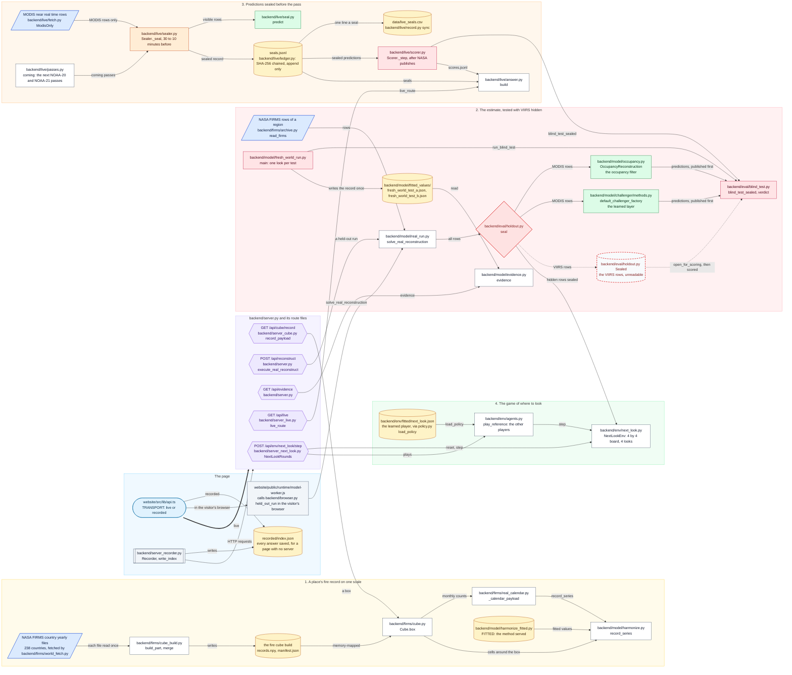

# Architecture

This document describes how Isogon is put together: the processes, the backend's route files and packages, the hidden
rows and the checks that keep them hidden, the tests fixed before their one look, the sealed live predictions, the
recording that lets the page run with no server, and the files the backend keeps. It is for engineers who read, check
or extend the code. Every box and every arrow below names the module or file it stands for.

Isogon's three parts are in the code as follows. The scientific world model is `backend/firms/` (the fire cube and the
record) and `backend/model/` (the harmonization, the occupancy filter and the learned layer that reads it). The
experimental environment is `backend/env/next_look.py`. The learning agent, the research direction, is the players in
`backend/env/agents.py`, `policy.py` and `learn.py`. The tests of the model are `backend/eval/` and the sealed
predictions are `backend/live/`.

## The data flow

| Shape and colour | What it is |
| --- | --- |
| Blue slanted box | NASA data coming in |
| White box | A Python module and the function that does the work |
| Amber cylinder | A file kept on disk |
| Purple hexagon | An HTTP route of the backend |
| Green box | A model that makes predictions: the occupancy filter, the learned layer, the live predictions |
| Pink box | A scorer or a test |
| Red diamond and red dashed cylinder | The wall: `seal` parts the rows, and the sealed VIIRS rows reach nothing but the scorer |
| Grey box | A tool, or the page's own code that calls the backend |
| Thick arrow, solid arrow, dotted arrow | The page's request; a call or a read, labelled with what it carries; the sealed rows' only way out |

## Processes

Isogon runs as two local processes. There is no database and no queue.

1. **The backend** (`backend/server.py`) is a Python standard library HTTP server on `127.0.0.1:8788`. It needs two
   packages outside the standard library, `numpy` and `Pillow`. The tool that downloads NASA's burned-area files
   (`backend/firms/burned_fetch.py`) can also use `h5py` or `pyhdf` to read them when they are installed; nothing the
   server serves needs either. Every route is described in [api.md](api.md).
2. **The site** (`website/`) is a React and TypeScript application built with Vite, on `127.0.0.1:5188` in
   development. It reads either the live backend or a recording of it (see below).

A fresh clone runs both with no data cache: the backend serves simulated runs, and the site draws the tracked files
under `website/public/generated/`. Real runs, the record and the tests need the local cache that [data.md](data.md)
describes. The backend's tests are run with `python3 -m unittest discover -s backend/tests`; the suite holds 886
tests, counted by the test loader, and the tests that need the data cache skip themselves without it.

### Two kinds of run, never mixed

- **A simulated run** models a fire on real terrain and the satellite passes over it (`backend/model/solver.py`,
  `backend/model/world_model.py`). It uses no FIRMS row.
- **A real run** (`"source": "firms"`) rebuilds a fire from cached NASA FIRMS rows (`backend/model/real_run.py`) on
  frames that are real satellite passes.

The two share the route, the answer's outer shape and the 24 by 256 by 256 by 4 tensor. They never share observations
or scores, and every answer says which kind it is.

## The server and its route files

`backend/server.py` holds the request handler (`do_GET`, `do_POST`) and the store, `IsogonDataStore`. The route files
are plain modules it imports; `do_GET` tries the cube's routes, then the photographs', then the burned-area route, then its own.

| File | What it answers | What it calls |
| --- | --- | --- |
| `backend/server.py` | `POST /api/reconstruct` (a run: simulated, real, held out, revealed), `GET /api/regions`, `/api/calendar` and its `checks`, `current` and `rows.csv`, `/api/evidence`, `/api/passes`, `/api/runs/starts`, the run assets under `/api/runs/<id>/`, `/api/observer`, `/api/sensor-model`, `/api/field-meta`, `/api/firms/countries`, `/api/health` | `solve_region_reconstruction` (`model/solver.py`), `solve_real_reconstruction` and `real_response` (`model/real_run.py`), `firms_calendar` and `box_calendar` (`firms/real_calendar.py`), `evidence` (`model/evidence.py`), `pass_timeline` (`firms/pass_timeline.py`) |
| `backend/server_cube.py` | `GET /api/cube/countries`, `/record`, `/tables`, `/layers`, `/years`, `/years/countries` | `Cube` (`firms/cube.py`); a box's record goes through `_calendar_payload` (`firms/real_calendar.py`) |
| `backend/server_live.py` | `GET /api/live`, also as a read-only server of its own | `build` (`live/answer.py`) |
| `backend/server_next_look.py` | `POST /api/env/next_look/reset`, `step`, `play`; `GET /api/env/next_look/state`, `players` (served by `server.py`) | `NextLookEnv` (`env/next_look.py`), `play_reference` (`env/agents.py`), `load_policy` (`env/policy.py`) |
| `backend/server_gibs.py` | `GET /api/gibs/day`, `/cloud`, `/live` | `build_day_image` (`terrain/gibs_day.py`); the main server reads the photograph cache only |
| `backend/server_burned.py` | `GET /api/burned`, NASA's burned-area map (MCD64A1) over a box and window | `mask` (`firms/burned.py`); it answers 404 "not fetched" where the world store holds no burned-area files |
| `backend/server_recorder.py` | no route: a tool that records the server's answers | a running backend, over HTTP |

The store holds the simulated field read at start, the 24 most recently used runs, the real calendars and start lists,
the next-look rounds (at most 16, each dropped after six idle hours), the terrain pack manager, and smaller caches of
pass timelines, box calendars and this month's counts. The cube is not in the store: `server_cube.py` keeps one reader
of the current build and its own cache of answers.

The handler keeps four guards. A `POST` from a page not served from this machine is refused. Request bodies are JSON
objects of limited size (64 KB for a round, 256 KB for a run), with no `NaN` or `Infinity`. Numbers in a query must be
finite. A client may hold a socket idle for at most 60 seconds.

## The packages

| Package | What it does |
| --- | --- |
| `backend/firms/` | NASA's fire rows and what is built from them. `world_fetch.py` downloads every country's yearly FIRMS files; `archive.py` keeps them with their manifests and holds `read_firms`, the reader of a region's rows. `cube_build.py` builds the fire cube and `cube.py` reads it (`Cube`). `real_calendar.py` makes a place's monthly record. `box_index.py` counts any box from the country files. `area_api.py` asks the FIRMS area API, `current_month.py` counts this month so far, `cmr_passes.py` lists every satellite pass from NASA CMR, `pass_timeline.py` joins passes with the detections on them, `burned.py` reads NASA's burned-area maps, `places.py` and `places.json` hold the places and their featured fires. `cube_years.py` and `cube_countries.py` make the yearly layers and each country's years, `cube_public.py` and `calendar_pack.py` the small files a page with no server sums a box or a place from, `cube_figure.py` the picture of the Earth in the README, `gibs_cloud.py` the cloud share beside a pass, and `passmask.py` with `passmask_fetch.py` NASA's per-pass fire and cloud masks. |
| `backend/model/` | The record's harmonization (`harmonize.py`, with its fitted values in `harmonize_fitted.py`; the other `harmonize_*.py` modules measure, fit and draw: `harmonize_eval.py` the held-out measurement, `harmonize_cells.py`, `harmonize_places.py`, `harmonize_dataset.py`, `harmonize_years.py`, `harmonize_countries.py`, `harmonize_maps.py` and `harmonize_figure.py`, all of [harmonization.md](harmonization.md)). The estimate for real rows: `real_run.py` (a run), `occupancy.py` (the forward and backward filter), `belief.py` (the belief every 30 minutes), `encoding.py` (the log byte scale), `platforms.py` and `real_geometry.py` (platform facts and pass geometry), `fitted.py` and `fitted_values/` (the values in use and the records of every look). The learned layer, the challenger: `challenger/` (`features.py` the features of a cell and of a pass, `linear_mlp.py` the logistic model, the small network and the stacker, `gbdt.py` the boosted trees, `heads.py` the total power and the pixel count, `declarations.py` the declared cells, `terrain_features.py`, `runner.py` the fit and the validation, `world_split.py`, `provenance.py`, `guard.py`), with `challenger_standing.py` and `fire_roles.py` saying what a place and window are to each model. Which rows may be learned from: `training.py`; `fit_real.py` fits the values, `real_blind.py` and `withhold.py` and `cached_platforms.py` make the run's test; `terra_morning.py` is the other direction, experimental. `calendar_model.py` is the simulated calendar and `calendar_ratio.py` the real calendar's ratio for the baseline. `numbers_build.py` says which build of numpy made an answer. The tests fixed before the look: `fresh_test.py`, `fresh_world.py`, `fresh_world_run.py`. The evidence document: `evidence.py`. Simulated runs: `world_model.py`, `sensor_physics.py`, `calibrator.py`, `solver.py`, `reconstruct.py`, `gates.py`. |
| `backend/eval/` | The blind test. `holdout.py` seals the hidden rows; `schedule.py` says when predictions are published, without reading a hidden row; `rows.py`, `overpass.py` and `grid.py` turn rows into overpasses on a 375 m grid; `baselines.py`, `metrics.py` and `blind_test.py` score the estimate beside the two simple methods. |
| `backend/env/` | The game: `next_look.py` (the environment), `agents.py` and `policy.py` (the reference players and the learned player, whose weights are `fitted/next_look.json`), `play.py`, `episodes.py`, `terrain.py` (elevation on an episode's 375 m grid), `learn.py`, `report.py`, and `fresh_world_players.py` (the players measured on the fresh test's fires). |
| `backend/live/` | The live test: `choose.py` (fires), `passes.py` (coming passes), `seal.py` and `sealer.py` (predictions and their seals), `ledger.py` (the chained logs), `scorer.py`, `answer.py` (the route's answer), `finals.py` (which line of the scores stands for each seal), `record.py` (the tracked seal log), `protocol.py`, `run.py`, `rehearse.py`. [live.md](live.md) describes it. |
| `backend/terrain/` | Elevation and imagery: `tile_store.py` (the tile cache), `terrain_pack.py` (the higher resolution pack and the context terrain), `live_region.py` (a region from a preset, a place name or coordinates), `gibs_day.py` (the day's photograph from NASA GIBS), `projections.py` and `resample.py`; `build_terrain.py`, `tile_fetcher.py`, `verify_terrain.py`, `pack_preview.py` and `glb_tools.py` are build and check tools. |
| `backend/` (top level) | `server.py` and its route files; `browser.py`, the page's entry point when the model runs in a visitor's browser, and `browser_pack.py`, the archive it unpacks; `public_lite.py`, small copies of every terrain pack so that a public page draws its first screen from a few megabytes; `server_recorder.py`, the recorder. |
| `backend/openspace/` | The exporter that writes an OpenSpace scene from one held-out run. Nothing else in the backend imports it. |

## The fire record

Every country's FIRMS yearly files, 238 countries, are read once into the fire cube (`backend/firms/cube_build.py`,
shape in [cube.md](cube.md)): monthly counts and fire radiative power for each cell of a quarter-degree grid, by
platform, day or night, kind, the pixel's size across the swath and confidence. A build is a folder of memory-mapped
arrays with a `manifest.json`; `GET /api/cube/countries` serves its row count, 548,501,203 rows.

A box's record is read from the cube (`Cube.box` in `backend/firms/cube.py`) and made into months by
`_calendar_payload` in `backend/firms/real_calendar.py`. Its counts on one scale come from `record_series` in
`backend/model/harmonize.py`: the method chosen by a rule written before any table (`pooled_month_size_v1` for counts,
`overlap_ratio_v1` for fire power, as `backend/model/harmonize_fitted.py` records), using the cells around the box
(`surround_from_cube`) where the box itself has few detections, with an 80 percent interval from held-out errors.

## A run, its hidden rows and the blind test

A real run with VIIRS hidden is a blind test, and the code is arranged so that the test cannot leak.

- `solve_real_reconstruction` (`backend/model/real_run.py`) reads the region's rows (`read_firms`) and parts them at
  once with `seal` (`backend/eval/holdout.py`). The window, the frames and the estimate are made from the visible
  rows alone: the estimate is `OccupancyReconstruction` (`backend/model/occupancy.py`), asked at each frame.
- The sealed box has one accessor, `open_for_scoring`. Only `backend/eval/blind_test.py` (`blind_test_sealed`,
  `reveal`) and `backend/env/next_look.py` call it, and `backend/tests/test_eval_holdout.py` reads the source tree and
  fails if any other module does.
- `blind_test_sealed` publishes every method's predictions before it opens the box, then scores them; `verdict` says,
  score by score, whether the estimate beat both simple methods.
- The server adds one step: a held-out run's first answer leaves out every key the scorer wrote
  (`withhold_scorer_keys` in `backend/model/withhold.py`) and names them in `withheld_until_reveal`; the same request with
  `"reveal": true` returns them. A run on a window of the closed test fires is refused before anything is estimated.

### The learned layer

The model is two layers. The occupancy filter (`OccupancyReconstruction`) keeps three numbers per 375 m cell and runs
forward and backward through the passes. The learned layer (`backend/model/challenger/`, numpy only) reads the filter's
fields and the visible detections near each cell, and gives each cell's chance of being detected through a small
neural network and boosted decision trees, blended. Which variant answers is named in
`challenger/fitted/default_challenger.json` and built by `default_challenger_factory` (`challenger/methods.py`) from
the visible rows. `challenger/guard.py` refuses a hidden row.

Which of the two answers a held-out run is one switch, `ISOGON_RUN_ESTIMATE` (`run_estimate` in
`backend/model/real_run.py`). In the code it is off, and the filter answers. With `challenger` set, the learned layer
answers the hidden passes and is scored beside the filter in the same blind test, and the run's answer names the model
that answered (`held_out_passes_answered_by`). The model in a visitor's browser sets it (`backend/browser.py`), so the
page's hidden passes are the learned layer's. The visible MODIS passes, the spread, the belief frames and the exports
stay with the filter. The sealed live predictions are the filter's alone (`backend/live/protocol.py` pins the filter's
values and the baseline's, and nothing there reads the learned layer).

### The model in a visitor's browser

A held-out run and a round of the game can be computed in the visitor's browser, with no server. `backend/browser.py` is
the entry point: Python compiled to WebAssembly, with numpy and Pillow, calling the functions the server calls
(`solve_real_reconstruction` for a run, `NextLookRounds` for a round). `backend/browser_pack.py` packs the modules a run imports and each
place's files into archives with a manifest of their sizes and digests, and `website/public/runtime/model-worker.js` loads
them. `withhold_scorer_keys` is the same function in both entry points (`backend/model/withhold.py`), so the two first
answers hold the same keys. The hidden rows are in the visitor's files and are public FIRMS rows; they are kept from the
estimate by the sealed box, not by their absence ([method.md](method.md)). Two builds of numpy differ in the last
decimals, so an answer names its build (`backend/model/numbers_build.py`) and two answers are compared figure by
figure, never by digest. A place the pack does not hold, and a browser where the runtime does not load, replay the
recording.

### The checks that delete and alter the hidden rows

No byte of an answer may depend on a hidden row until the reveal. The tests check it by comparing bytes:

- `backend/tests/test_model_hidden_rows.py` deletes and alters a run's hidden rows (the perturbations of
  `backend/eval/synthetic_fixture.py`) and requires the estimate, the belief frames, the exports, the declared cells
  and every key of the answer outside the scorer to stay byte for byte the same, while the scores do change.
- `backend/tests/test_env_hidden_rows.py` does the same for the game's observations, and
  `backend/tests/test_server_next_look.py` plays a round twice, the second time with every unrevealed hidden row
  deleted, and requires every other field to be equal.
- `backend/tests/test_model_run_challenger.py` and `backend/tests/test_model_challenger_safety.py` hold the learned
  layer to the same rule.

## The tests fixed before the look

The test across the world is written down before any of its fires is read ([method.md](method.md)).

- `backend/model/fresh_test.py` holds the protocol and its SHA-256 digest (`protocol_sha256`).
- `backend/model/fresh_world.py` builds the plan of fires from MODIS files alone and records the protocol's digest in
  it; `fresh_world_run.py` refuses a plan whose digest or protocol does not match.
- A look is taken once: `fresh_world_run.py` refuses to write a look whose record already exists. Each look scores its
  fires with `run_blind_test` (`backend/eval/blind_test.py`) and writes its record to
  `backend/model/fitted_values/` (`fresh_world_test_a.json`, `fresh_world_test_b.json`, with the plan, the refit and
  the players' records beside them), each naming the protocol's digest and the plan's.
- `evidence` (`backend/model/evidence.py`) reads those records and serves them at `GET /api/evidence`.

## The live test

The live test predicts passes that have not happened yet ([live.md](live.md)).

- Every 24 hours `backend/live/choose.py` picks fires from the last two days of MODIS near real time rows alone.
- `coming` (`backend/live/passes.py`) finds each fire's coming NOAA-20 and NOAA-21 passes from the same satellites'
  passes 16 days before.
- Between 30 and 10 minutes before a pass, `Sealer._seal` (`backend/live/sealer.py`) has the three methods predict
  from MODIS rows alone (`predict` in `backend/live/seal.py`), writes their arrays under their digest, and appends the
  record to `seals.jsonl` through `Ledger.append` (`backend/live/ledger.py`): the SHA-256 of the record's canonical
  JSON, chained to the line before it, in a file opened for appending only.
- `record.sync` (`backend/live/record.py`) copies each seal's time, digest, fire, satellite and predicted minute into
  the tracked `data/live_seals.csv`, whose written lines are never changed.
- After NASA publishes the pass, `Scorer._step` (`backend/live/scorer.py`) checks each sealed digest and scores the
  predictions with `blind_test_sealed`, unchanged. `build` (`backend/live/answer.py`) makes the answer of
  `GET /api/live`.

## The game

`NextLookEnv` (`backend/env/next_look.py`) plays one real run cut into a board of 4 by 4 tiles, with a budget of four
looks at the hidden satellite's scheduled passes. It seals the hidden rows as a run does, and an observation holds only
the hidden rows its looks have revealed. The reward of a look is the score after it minus the score before, both on
every hidden detection of the episode. `NextLookRounds` (`backend/server_next_look.py`) holds the rounds, and plays the reference players
(`play_reference` in `backend/env/agents.py`), the learned player among them (`load_policy` in `backend/env/policy.py`).

## The recording

A page with no backend reads a recording instead. `backend/server_recorder.py` asks a running backend for every answer
on a plan of requests (by default the demo path of the featured fires), each built with the body the page builds, and
writes the answers and assets into one folder with an `index.json` keyed by method, path with its query sorted, and
body. Imagery whose licence does not allow a copy is left out and listed as withheld. For the public page the terrain
packs also get small copies (`backend/public_lite.py`), so the first screen comes in a few megabytes and the full pack
follows, and the cube's monthly counts become one small file a browser sums any box from (`backend/firms/cube_public.py`). After writing, the tool checks
every file for the FIRMS key, `MAP_KEY=` and local paths, and fails if one holds any. The site reads the folder when it
is built with `VITE_TRANSPORT=recorded` (`website/src/lib/api.ts`); a request with no recorded answer says so in one
line.

## Files and formats

Isogon keeps flat files. Each downloaded file has a manifest beside it with its source and SHA-256.

| Path | Tracked | Holds |
| --- | --- | --- |
| `backend/model/fitted_values/` | Yes | The estimate's fitted values, the records of every look at the test fires, the fresh test's plan, looks, refit and players |
| `backend/model/harmonize_fitted.py` | Yes | The harmonization's fitted values and the method served |
| `backend/model/challenger/fitted/` | Yes | The learned layer's fitted variants and the pointer to the default one |
| `backend/env/fitted/` | Yes | The learned player and its reference tables |
| `data/live_seals.csv` | Yes | One line per live seal, never changed once written |
| `website/public/generated/` | Yes | The Feather River terrain and one simulated field, for running without a backend |
| `data/cache/` | No | FIRMS rows, the fire cube, the pass list, map tiles, built terrain and the live test's folder ([`data/README.md`](../data/README.md)) |

### Binary formats

- **Elevation** (`dem_f32.bin`, `dem_hires_f32.bin`, `dem_1024_f32.bin`, `context_dem_1024_f32.bin`, `ca_dem_f32.bin`):
  little-endian float32, metres, square, row 0 at the north edge. 256, 512 or 1024 posts on a side.
- **The reconstruction tensor** (`reconstruction_u8.bin`): 24 frames by 256 by 256 cells by 4 bytes, 6,291,456 bytes.
  The channels are the estimate, its uncertainty, MODIS as observed and VIIRS as observed.
  - A simulated run is linear: 0 to 80 MW/km2 over bytes 0 to 255, and 0 to 24 MW/km2 for the uncertainty.
  - A real run is logarithmic (`backend/model/encoding.py`): byte 0 is exactly zero, and bytes 1 to 255 span 0.01 to
    10,000 MW/km2 evenly in `log10`.
- **Belief frames** (`belief_u8.bin`, real runs only): steps by rows by columns by 2 bytes on the 375 m grid, one step
  every 30 minutes. Channel 0 is the probability that the cell is burning, divided over 255; channel 1 is the expected
  power on the log scale above. Each step uses only the passes up to its time.
- **The fire cube**: records of month, code, rows and fire power per cell, laid out in [cube.md](cube.md).

## The OpenSpace exporter

`backend/openspace/export.py` writes a scene folder that OpenSpace, open-source planetarium software, can load: the
passes over a region, what MODIS detected, the estimate made from MODIS alone, and then what VIIRS detected. It is a
client of the backend and keeps the blind test's order: every file before the reveal is written from the held-out
answer, and the hidden detections are fetched last. `backend/tests/test_openspace_modular.py` checks that nothing else
imports it.

## Determinism and caches

- Rows are read in a fixed order and the real estimate has no random step. The bootstrap that classifies scores uses a
  fixed seed (`backend/eval/blind_test.py`).
- A simulated run derives its seed from the region's id and box, so the same request gives the same run.
- A real run is stored under what decides it: the region, the start, what is hidden, a digest of the region's rows and
  a digest of the fitted value files.
- The start search is cached under `data/cache/firms/derived/`, keyed by the rows and a digest of the source of the
  rule.
- The reference players of a round are played once per episode and kept under `data/cache/next_look_reference/`, keyed
  by a digest of everything their results follow from.
- Terrain pack files are served with an `ETag` and may be kept by the browser for a day. Everything else is `no-store`.

## Coordinates and registration

1. **Rows and columns.** In every backend raster, row 0 is the north edge and column 0 the west edge.
2. **Posts and pixels.** Elevation grids are registered on posts: the first sample sits on the north-west corner of the
   box and the last on the south-east corner. Images are registered on pixels over the same box.
3. **The 375 m grid.** `EvalGrid` (`backend/eval/grid.py`) lays 375 m cells over a box with 111.132 km per degree of
   latitude and that times the cosine of the box's mid latitude per degree of longitude. When a real run packs its
   tensor, each of the 256 by 256 cells takes the value of the 375 m cell that holds its centre (`_tensor_index` in
   `backend/model/real_run.py`).
4. **The cube's grid.** A quarter of a degree, 1440 columns by 720 rows, row 0 at the north ([cube.md](cube.md)).
5. **The stage.** Before upload, rows are flipped so that texture row 0 is south (`createDemR32FTexture` and
   `alignReconstructionTensor` in `website/src/stage/earthCutawayShaders.ts`).

## Related documents

- [`../README.md`](../README.md): what Isogon is and how to run it
- [data.md](data.md): where the data comes from and how the cache is filled
- [cube.md](cube.md): the fire cube
- [harmonization.md](harmonization.md): the record on one scale
- [method.md](method.md): the method, the protocol of the blind test and the results
- [live.md](live.md): the live test
- [api.md](api.md): every route
- [sources.md](sources.md): credits and licences
- [`../website/README.md`](../website/README.md): the site's commands and layout
